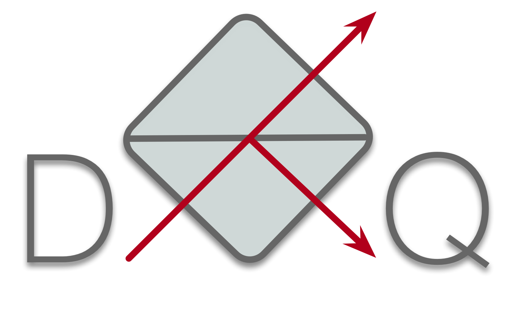

<div align="center">
  

  <h1>OptiDAQ</h1>

  <p>Scan, capture in sync, export datasets.</p>
</div>

## Purpose

Optics experiments that pair a scanned source with several cameras need three things at once: the scan must run, every camera must keep recording, and each frame must be saved with metadata that links it to its scan step. OptiDAQ does this for experiments at CERN CLEAR and for the optical lab. It moves the source with motors, magnets or a DMD, records all cameras while the scan runs, and turns the recording into an image dataset with one database file.

## Structure


Package paths are relative to `src/optidaq/`.

| Block | What it does | Code |
| --- | --- | --- |
| Control | One JSON config describes the run. A runner checks it, the devices and the data folder, then steps one actuator through the scan: motor row sweep, magnet list, raster or random walk, DMD patterns (Gaussian or from a PNG folder), or none. | `experiments/experiment_v1.py` (beam time), `experiments/experiment_lab_v1.py` (lab); `daq/`: `engine.py`, `preflight.py`; `actuators/`: `motor_row_sweep.py`, `magnet_current_scan.py`, `magnet_raster_scan.py`, `magnet_random_walk.py`, `dmd_pattern_scan.py`, `noop.py`; `data/pattern_stream.py`, `extensions/sgm.py` |
| Acquisition | Each camera streams in its own thread, independent of the scan. Frames carry the camera's timing fields and go through a bounded queue to one writer thread. A watchdog flags stalled cameras; magnet currents (optional) and DMD steps are logged alongside. | `daq/`: `contracts.py`, `pipeline.py`, `sync_tools.py`, `watchdog.py`, `magnet_logger.py`, `actuator_events.py` |
| Saved run | One folder per run: each camera's frames with a timing file, and the configuration as applied. Beam-time runs store the unchanged camera bytes; lab runs store PNGs, cropped and binned while saving when the config sets it. | `daq/`: `run_store.py`, `save_backends.py`, `raw_stream.py`; `data/`: `png_io.py`, `hooks.py`, `transforms.py` |
| Offline processing | Groups frames across cameras by timestamp and writes `dataset.db`. Raw runs are exported to one PNG folder per camera, optionally cropped and binned; beam-time runs also get stream checks and a cross-camera index. An optional check of lab DMD runs writes a PDF report. | `parse/export_scientific_png.py`; `data/`: `scientific_png_export.py`, `raw_run.py`; `daq/offline_validate.py`; `after_collection.py`; `analysis/`: `analyze_run.py`, `clean_plots.py` |
| Analysis | One config drives three separate parts: dataset adapters (now `dataset.db` plus PNGs, with background subtraction as a preprocessing step), pipeline steps that write artefacts (tables and arrays), and figures drawn from the artefacts only. The first step is the forward fit: it rebuilds the fibre image of a measured beam from a laser-spot scan. Each beam frame becomes one weight per spot (corrected: nearest spot at its local centroid; decomposed: non-negative fit of the spot images); the spots' fibre images are added up with these weights and compared with the recorded fibre image by several metrics. Its figure shows measured and synthetic images per fibre and fit. Adapters, preprocessing steps, spot selection rules, fits, steps and figures are chosen by name in the config; each of them, and each metric, is one entry in a table in the code. Run everything with `python -m optidaq.analysis.pipeline --config configs/analysis_v1.json`; add `--figures` to redraw from the artefacts without recomputing. | `analysis/`: `pipeline.py`, `datasets.py`, `config.py`; `analysis/forward_fit/`: `model.py`, `metrics.py`, `run.py`; `analysis/figures/`: `style.py`, `fit_samples.py` |
| Lab motor raster | Separate lab path: moves to each grid point, checks the motor readback, saves one camera pair per point under a capture ID, and builds `dataset.db` from the committed pairs. | `actuators/motor_point_raster.py`; `daq/`: `lab_motor_run.py`, `lab_capture.py`; `extensions/lab_camera.py`; `data/lab_png_finalize.py` |
| Hardware adapters | Device access, kept apart from the logic above: CERN devices through PyDA (login, cameras, magnets, motors) and the ViALUX DMD driver. | `extensions/`: `cern_pyda.py`, `vialux_alp.py` |
| Tools | Camera preview, background frames, manual motor, DMD and filter-wheel control, scan-area validation, and conversion to HDF5 or PNG. | `experiments/`: `camera_preview.py`, `background_acquire.py`, `motor_control.py`, `dmd_control.py`, `filter_wheel_control.py`, `scan_area_validation.py`, `parse_process.py` |
| Diagnostics | Exposure calibration, magnet readout, live quad-scan viewing, and fiber coupling checks. | `tests/`: `exposure_probe.py`, `read_magnets.py`, `quad_scan_view.py`, `fiber_coupling_check.py` |

Design rules:

- Raw runs keep the camera bytes, so processing is offline and repeatable; lab PNG runs crop and bin while saving.
- Each scan type is one actuator class; a new one also needs its mode name in the runner.
- Storage backends share one interface: raw streams for beam time, PNG for the lab.

## Minimal example

Acquisition needs a CERN acc-py environment with `pyda`, `pyda_rda3` and `pyrbac`. Offline export needs only Python and NumPy. From the repository root:

```bash
python -m pip install --no-build-isolation -e .
```

Copy the example configurations to their working names, which Git ignores:

```bash
for f in configs/*.example.json; do cp -n "$f" "${f%.example.json}.json"; done
```

In `configs/experiment_v1.json`, set `run.data_root`, replace the camera and motor device placeholders, and adjust camera settings and scan coordinates to your hardware. The supplied values are examples.

Start acquisition:

```bash
python experiments/experiment_v1.py --config configs/experiment_v1.json
```

This records two cameras during a motor row sweep. Keep all files of the run folder together.

Export the finished run, using its actual folder name:

```bash
python parse/export_scientific_png.py --config parse/export_config_full.json --run-dir /path/to/data_root/runs/run_YYYYMMDDTHHMMSSZ --out-dir ./outputs/dataset
```

The export writes one PNG folder per camera plus `dataset.db`. Adjust the crop in the export configuration to your images, or set `crop_enabled` to `false` to keep full frames.

For lab runs with a DMD or a point-by-point motor raster, use `experiments/experiment_lab_v1.py` with `configs/experiment_lab_v1.json` or `configs/experiment_lab_motor_raster.json`. These save PNGs and `dataset.db` during acquisition.
