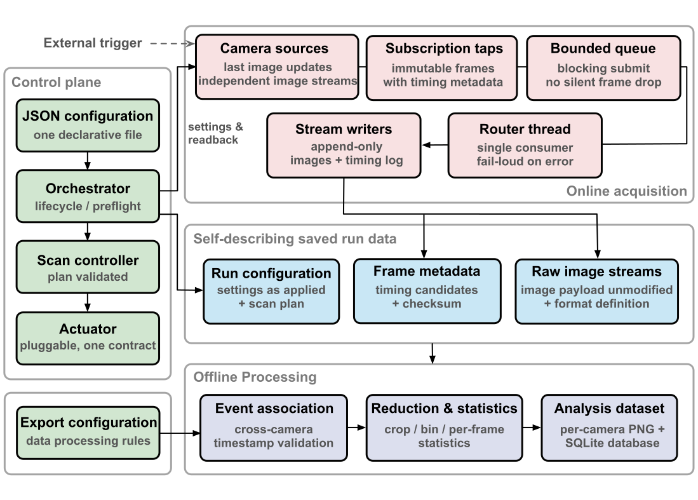

<div align="center">
  

  <h1>OptiDAQ</h1>

  <p>Scan, capture in sync, export ML-ready data.</p>
</div>

## Purpose

Optics experiments that pair a scanned source with several cameras need three things at once: the scan must run, every camera must record without dropping frames, and each frame must later be traceable to its scan step. OptiDAQ does this for experiments at CERN CLEAR and for the optical lab. It moves the source with motors, magnets or a DMD, records all cameras while the scan runs, and turns the recording into an image dataset with one database file.

## Structure



| Block | What it does | Code |
| --- | --- | --- |
| Control | One JSON file describes the run. The runner checks it, then steps the actuator through the scan. | `experiments/`, `src/optidaq/actuators/` |
| Acquisition | Cameras stream in background threads, independent of the scan. Frames are immutable and carry their timing. | `src/optidaq/daq/` |
| Saved run | Unmodified frame bytes, timing files and the configuration as applied. The folder describes itself. | `src/optidaq/daq/` |
| Offline processing | Matches frames across cameras by timestamp, crops and bins, writes PNGs and `dataset.db`. | `src/optidaq/data/`, `parse/` |
| Hardware adapters | CERN device access and the DMD driver, kept apart from the logic above. | `src/optidaq/extensions/` |

Design rules:

- Acquisition never alters pixels. All image processing happens offline and can be repeated.
- Actuators share one contract, so a new scan type is one new file.
- Storage backends share one interface: raw streams for beam time, PNG for the lab.

## Minimal example

Acquisition needs a CERN acc-py environment with `pyda`, `pyda_rda3` and `pyrbac`. Offline export needs only Python and NumPy. From the repository root:

```bash
python -m pip install --no-build-isolation -e .
```

Copy the example configurations to their working names, which Git ignores:

```bash
for f in configs/*.example.json; do cp -n "$f" "${f%.example.json}.json"; done
```

In `configs/experiment_v1.json`, set `run.data_root`, replace the camera and motor device placeholders, and adjust camera settings and scan coordinates to your hardware. The supplied values are examples.

Start acquisition:

```bash
python experiments/experiment_v1.py --config configs/experiment_v1.json
```

This records two cameras during a motor row sweep. Keep all files of the run folder together.

Export the finished run, using its actual folder name:

```bash
python parse/export_scientific_png.py --config parse/export_config_full.json --run-dir /path/to/data_root/runs/run_YYYYMMDDTHHMMSSZ --out-dir ./outputs/dataset
```

The export writes one PNG folder per camera plus `dataset.db`. Adjust the crop in the export configuration to your images, or set `crop_enabled` to `false` to keep full frames.

For lab runs with a DMD or a point-by-point motor raster, use `experiments/experiment_lab_v1.py` with `configs/experiment_lab_v1.json` or `configs/experiment_lab_motor_raster.json`. These save PNGs and `dataset.db` during acquisition.
